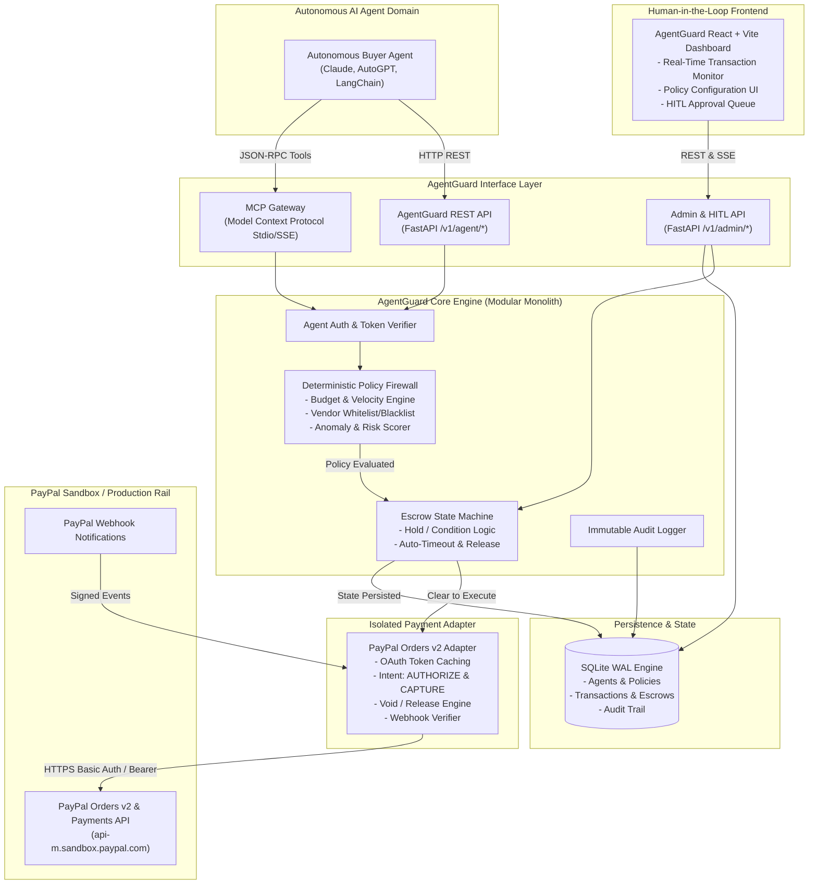
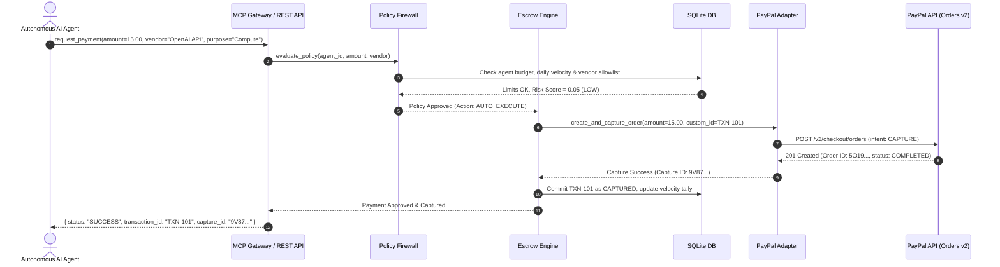
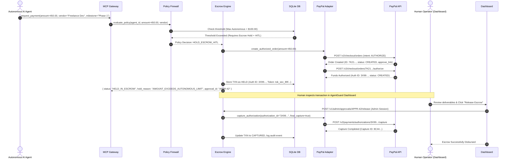
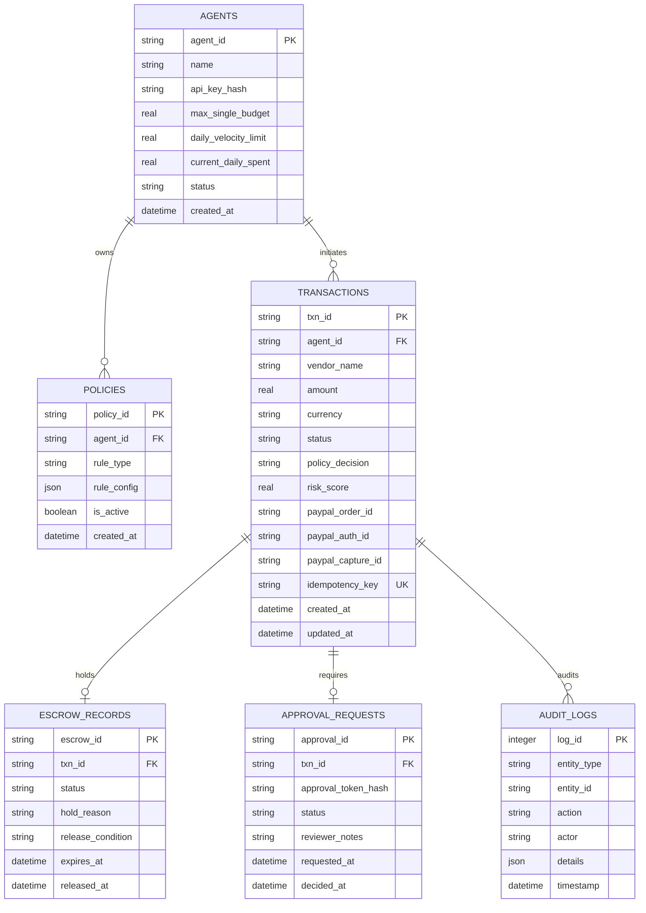

# AgentGuard: System Architecture

> **System**: AgentGuard - Policy Firewall & Escrow for Autonomous AI Payments  
> **Status**: Accepted / Baseline  
> **Date**: 2026-11-10  
> **Author**: Lead Software Architect & Senior Python Engineer  
> **Protocol**: Yuntra 2.0  

---

## 1. Executive Summary & Problem Space

As autonomous AI agents acquire tool-use capabilities to purchase computational resources, cloud APIs, digital assets, and subagent services, the risk of unconstrained, non-deterministic, or compromised spending escalates dramatically.

**AgentGuard** is an institutional-grade Policy Firewall and Escrow Gateway positioned between autonomous AI agents (the "Buyers") and the PayPal payment rail.

### Core Guarantees:
1. **Zero Credential Exposure**: AI agents and frontend clients never touch PayPal Client Secrets, Access Tokens, or raw payment rails.
2. **Deterministic Firewalling**: All payment policies (velocity limits, budget caps, vendor allowlists, anomaly detection) are executed by immutable, deterministic code—completely isolated from non-deterministic LLM reasoning or prompt injection vulnerabilities.
3. **True Escrow via PayPal Authorization**: High-risk or milestone-based payments leverage PayPal Orders v2 `intent: "AUTHORIZE"` to lock funds securely on PayPal infrastructure without capturing until agent verification or human milestone approval is satisfied.
4. **Agent-Native Protocol**: AI agents interact exclusively via the open Model Context Protocol (MCP) or an authenticated REST proxy, enforcing complete sandbox confinement.

---

## 2. High-Level System Architecture

AgentGuard is designed as a **modular monolith** with clean architectural boundaries, low operational overhead, and high auditability.



---

## 3. Modular Monolith Subsystems & Domain Boundaries

The backend is strictly partitioned into domain packages under `src/agentguard/`:

| Module | Purpose | Allowed Inbound Dependencies | Prohibited Direct Access |
| :--- | :--- | :--- | :--- |
| **`core`** | Configuration, Pydantic base models, SQLite connection lifecycle, security primitives. | All modules | Must not import domain modules |
| **`firewall`** | Deterministic evaluation of transaction rules: spending caps, velocity limits, vendor allowlists/blocklists, regex content filters, anomaly scoring. | `api`, `mcp` | Must not import `paypal` adapter |
| **`escrow`** | Escrow lifecycle management (`PENDING_REVIEW`, `HELD`, `APPROVED`, `CAPTURED`, `VOIDED`, `REFUNDED`). | `api`, `mcp`, `firewall` | External agents cannot directly trigger state transitions |
| **`paypal`** | **Isolated Payment Adapter**. Handles OAuth2 client credentials, token caching, Orders v2 creation (`AUTHORIZE`/`CAPTURE`), authorization captures, voids, and webhook verification. | `escrow` exclusively | **Strictly prohibited** from direct invocation by `api`, `mcp`, or frontend |
| **`mcp`** | Model Context Protocol gateway. Exposes tools (`request_payment`, `check_payment_status`, `simulate_transaction`, `list_approved_vendors`) to AI agents over stdio/SSE. | External AI processes | Cannot access PayPal adapter directly; routes strictly through `firewall` |
| **`api`** | FastAPI routing layer (`/v1/agent`, `/v1/admin`, `/v1/webhooks`, `/health`). | HTTP clients, Dashboard | Cannot execute PayPal payments without traversing `firewall` and `escrow` |

---

## 4. End-to-End Transaction Lifecycle

### Flow A: Autonomous Low-Risk Transaction (Direct Policy Pass & Auto-Capture)


### Flow B: High-Risk / Milestone Escrow (Intent: AUTHORIZE + Human-in-the-Loop)


---

## 5. PayPal Orders v2 API Integration Contract

All external payment operations are strictly encapsulated inside `agentguard.paypal.adapter.PayPalAdapter`:

1. **OAuth2 Token Manager**:
   - `POST /v1/oauth2/token`
   - Cache token in-memory with expiration guard (refresh 5 minutes prior to TTL).
   - Thread-safe / async-safe mutex prevents token fetch race conditions.
2. **Order Creation (`intent: AUTHORIZE` or `intent: CAPTURE`)**:
   - Endpoint: `POST /v2/checkout/orders`
   - Headers:
     - `Authorization: Bearer [REDACTED]`
     - `PayPal-Request-Id: <idempotency_key>`
     - `Content-Type: application/json`
   - Standard payload:
     ```json
     {
       "intent": "AUTHORIZE",
       "purchase_units": [
         {
           "reference_id": "default",
           "custom_id": "AGENTGUARD_TXN_UUID",
           "description": "Agent Payment for: Compute Engine",
           "amount": {
             "currency_code": "USD",
             "value": "150.00"
           }
         }
       ]
     }
     ```
3. **Authorize Order**:
   - Endpoint: `POST /v2/checkout/orders/{order_id}/authorize`
   - Extracts and persists `purchase_units[0].payments.authorizations[0].id`.
4. **Capture Authorization (Escrow Settlement)**:
   - Endpoint: `POST /v2/payments/authorizations/{authorization_id}/capture`
   - Payload:
     ```json
     {
       "amount": { "currency_code": "USD", "value": "150.00" },
       "final_capture": true,
       "note_to_payer": "AgentGuard verified release condition satisfied."
     }
     ```
5. **Void Authorization (Escrow Cancellation / Refund)**:
   - Endpoint: `POST /v2/payments/authorizations/{authorization_id}/void`
   - Releases held buyer funds if policy is violated or task fails.
6. **Webhook Signature Verification**:
   - Endpoint: `POST /v1/notifications/verify-webhook-signature`
   - Verifies incoming payloads against PayPal transmission headers:
     `paypal-auth-algo`, `paypal-cert-url`, `paypal-transmission-id`, `paypal-transmission-sig`, `paypal-transmission-time`.

---

## 6. Database Schema (SQLite with WAL Mode)



---

## 7. Model Context Protocol (MCP) Gateway

AgentGuard provides a native MCP server for seamless integration with modern agent runtimes (Claude Code, Cursor, AutoGPT, LangChain, custom agents).

### Exposed MCP Tools:
1. **`request_payment`**:
   - Parameters: `amount` (float), `currency` (ISO-4217, default "USD"), `vendor` (string), `purpose` (string), `milestone_id` (optional string), `idempotency_key` (UUID string).
   - Behavior: Enters policy firewall. Returns immediate approval & capture or escrow hold details.
2. **`check_payment_status`**:
   - Parameters: `transaction_id` (string).
   - Behavior: Queries live state of transaction/escrow.
3. **`simulate_transaction`**:
   - Parameters: `amount` (float), `vendor` (string).
   - Behavior: Dry-runs through policy firewall without triggering PayPal APIs, reporting what policies would fire.
4. **`list_approved_vendors`**:
   - Parameters: none.
   - Behavior: Returns allowlisted vendors and approved merchant categories.

---

## 8. Frontend Architecture (React, Vite, TypeScript, Tailwind)

The operator dashboard provides single-pane-of-glass observability and human-in-the-loop control:
1. **Firewall Live Monitor**: Real-time ticker of agent payment requests, status badges (`CAPTURED`, `HELD`, `REJECTED`, `VOIDED`), risk score radar.
2. **Escrow Vault & HITL Approval Queue**: Active authorizations held on PayPal. Single-click "Approve & Capture" or "Reject & Void" with cryptographic token verification.
3. **Policy Rules Manager**: Interactive configuration of per-agent budget caps, rolling 24-hour velocity windows, and vendor whitelists.
4. **Agent Simulator / Sandbox**: Built-in test console to dispatch synthetic agent payment payloads and verify policy enforcement live.

---

## 9. Security Boundary Invariants

1. **Isolation Invariant**: The PayPal adapter credentials (`PAYPAL_CLIENT_ID`, `PAYPAL_CLIENT_SECRET`) never leave the backend process environment.
2. **Determinism Invariant**: No LLM prompt or output is ever permitted to override a deterministic firewall rejection.
3. **Idempotency Invariant**: Every transaction carries an idempotency key mapped to PayPal's `PayPal-Request-Id` to guarantee zero double-charging under network retries.
4. **Audit Immutability**: All decisions (firewall evaluations, approvals, holds, captures, voids) generate append-only audit records.
